# Track Studio user guide

Track Studio is where RC Misfits clubs draw their carpet and astro track layouts. This guide is for club members and committee members. It takes you from signing in to a layout you can print, build and race.

Written against rctrack 1.12, in November 2026. The pictures use example layouts and made-up halls and people. This guide is also in the app: choose **Help** in the menu.

<!-- contents -->
**Contents**

1. [Getting started](#getting-started)
2. [Start a layout](#start-a-layout)
3. [Draw the track](#draw-the-track)
4. [Edit](#edit)
5. [Check and finish](#check-and-finish)
6. [Share](#share)
7. [On a tablet or phone](#on-a-tablet-or-phone)
8. [FAQ](#faq)
<!-- /contents -->

## Getting started

### What Track Studio is

Track Studio does four jobs:

- **Draw a layout.** You lay the lanes on a grid, then shape the corners and add jumps, marshal points and the start line.
- **Check it.** It measures the lap, warns about lanes that overlap, and checks the layout against a hall's size, pillars and other fixed obstacles.
- **Build it.** The build sheet is a printable plan with every corner measured from the hall's walls.
- **Share it.** Layouts go into the club library, can be shown on the forum and attached to meetings, and can be driven in the sim.

The **library** is the first page you see. Anyone can look at it without signing in.

### Sign in with your forum account

1. Select **Sign in**, top right.
2. Sign in on the forum, if it asks. Track Studio uses your RC Misfits forum account: there is no separate password.
3. You come back to the page you were on, with your forum name top right.

If you are already signed in on the forum, Track Studio signs you in by itself.

You can try the designer without signing in. Your drawing is kept on that device, but you need to sign in to save it.

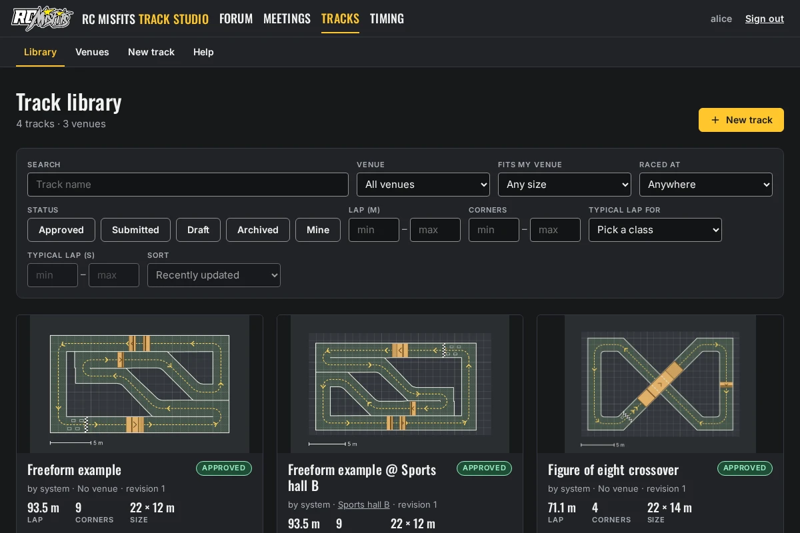

### Find your layouts

1. Open **Library**.
2. Under **Status**, select **Mine**. The list now shows only the layouts you made.

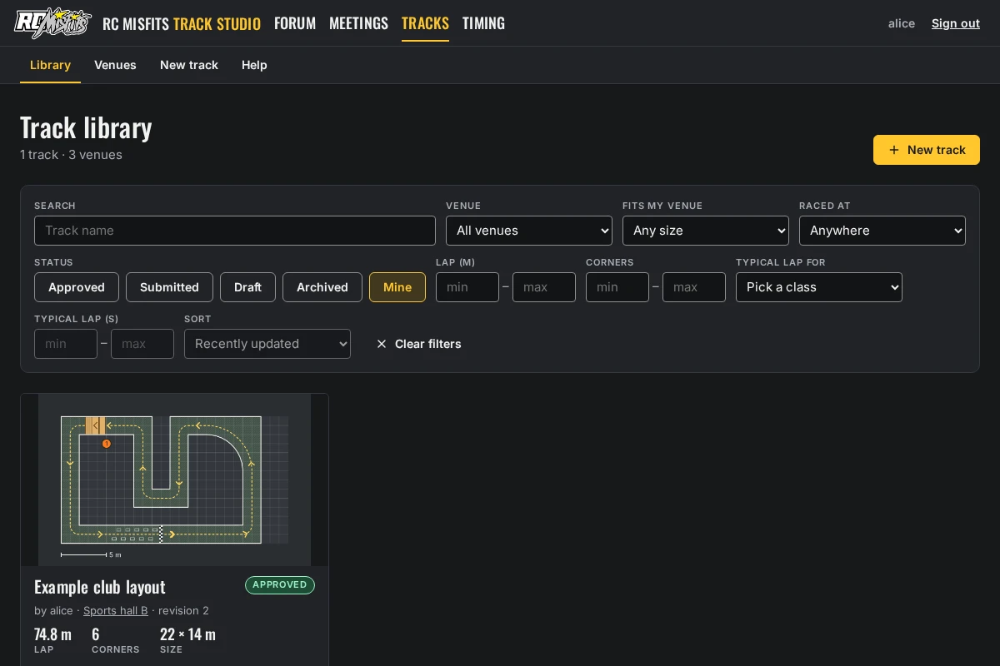

The other filters narrow the list: search by name, by venue, by lap length or number of corners, or **Fits my venue** to see only layouts that fit a hall.

Select a layout to open its page. The page shows the plan, the lap length, the checks, and the buttons to edit, print and share it.

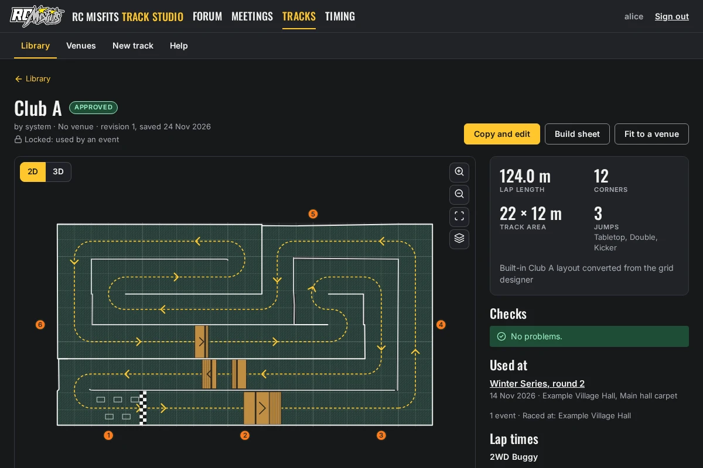

### The venue library

**Venues** lists the club's venue templates. A venue template is a hall's usable track area, its surface, its rostrum side, its timing loop, its pit area and its fixed obstacles, such as pillars and fire exits. New layouts can start from one, and any layout can be checked against one.

A template linked to a track on the forum takes its surface from that track's details on the forum, such as carpet or astroturf, with whether it's indoors or outdoors. Track Studio shows it but doesn't keep its own copy: to change it, follow **Set on the forum** to the venue's page on the forum and edit the track there. Track Studio picks up the change within 10 minutes. A grass track shows as grass, but layouts drawn there get no surface, because Track Studio has no grass surface yet. A template with no forum track has its own **Surface** to pick.

The committee of the club that runs the venue on the forum, and Track Studio's organisers, add and edit venue templates. The committee's guide to setting up a venue is with the club guides on the [forum](https://forum.rcmisfits.org/).

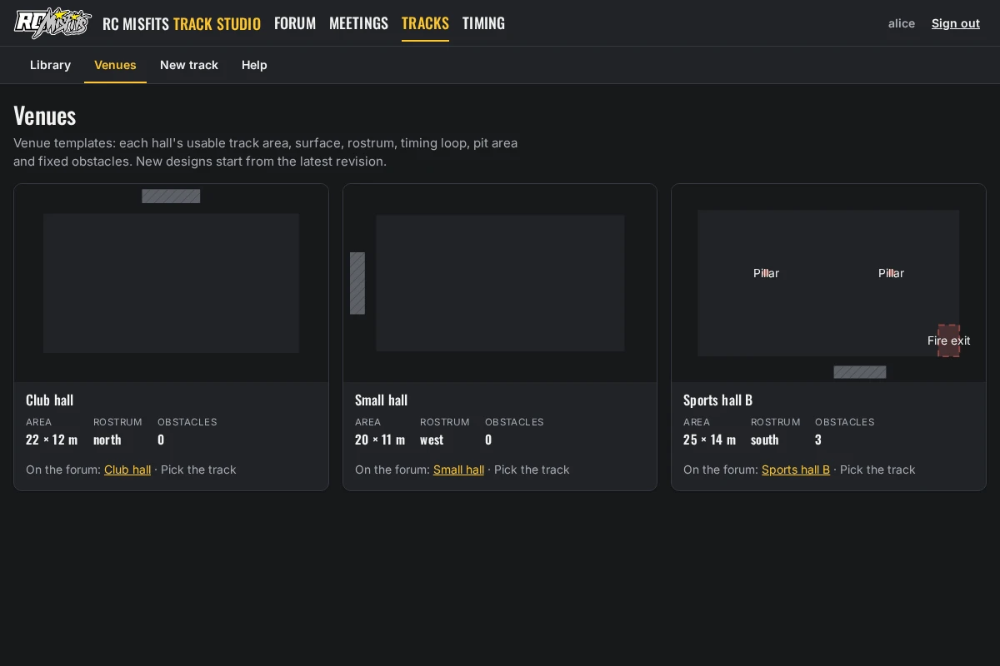

### Themes

Track Studio uses the theme you chose on the forum. There is nothing to set here: change your theme on the forum and Track Studio follows.

If you have not chosen a theme, you get your club's, or the standard dark or light theme to match your device.

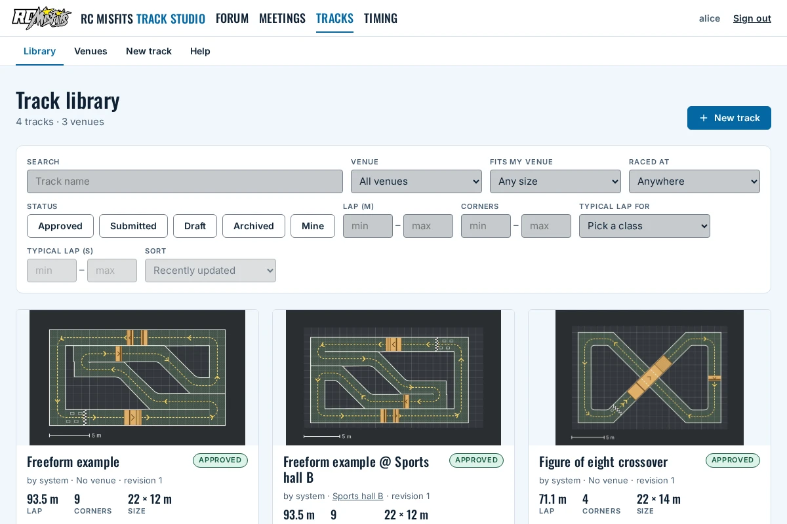

## Start a layout

### Open New track

Select **New track** in the menu, or the **New track** button in the library.

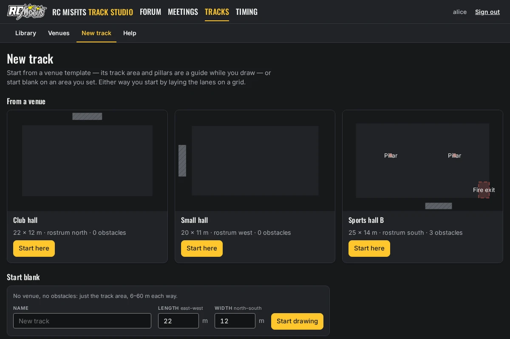

You have two ways to start.

### Start from a venue template

Select **Start here** on the hall's card.

The designer opens with the hall's track area, its obstacles, its pit area and its timing loop drawn in. They are a guide while you draw. They are not saved with the layout, so the same layout can be used in other halls later. The layout does take the hall's surface, such as carpet or astro, when the template gives one.

### Start blank

Use this when there is no template for the hall, or you just want to sketch.

1. Under **Start blank**, type a **Name**.
2. Type the **Length** (east to west) and the **Width** (north to south) of the track area, in metres. Each can be 6 to 60 m.
3. Select **Start drawing**.

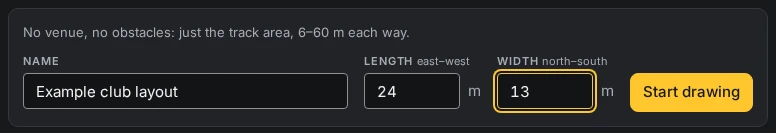

### The scale and the grid

The designer opens on step 1, **Lay the lanes**.

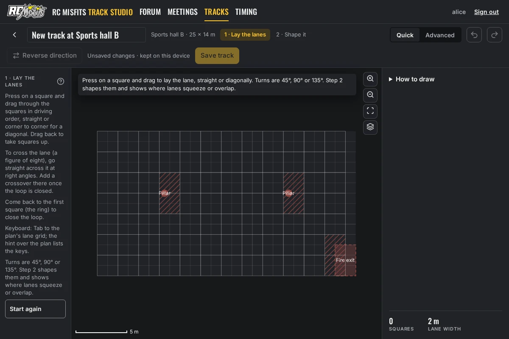

- **North is up**, east is to the right. Everything is in metres.
- **The grid squares are one lane wide.** A lane is 2 m wide unless you change it, so each square is 2 m.
- **The scale bar**, bottom left, shows a round length, such as 2 m or 5 m, at the current zoom. On a tablet it is top left.
- **Hatched squares** are too close to an obstacle to lay a lane through.
- Once the lanes are laid, the plan shows fine lines every 1 m and bolder lines every 5 m.

To move around the plan:

- **Zoom** with the mouse wheel, the **+** and **−** buttons top right of the plan, or the <kbd>+</kbd> and <kbd>−</kbd> keys.
- **Pan** by dragging an empty part of the plan.
- **Fit to view** (the square button, or <kbd>0</kbd>) shows the whole plan again.
- **Layers** (the stacked button) shows or hides parts of the drawing, such as the grid, the racing line or the obstacles.

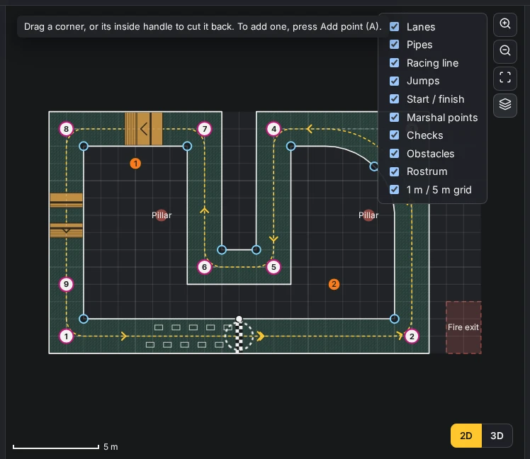

## Draw the track

Drawing has two steps. In step 1 you lay the lanes: the rough route. In step 2 you shape it: corners, jumps, marshal points and the start line.

The **?** at the top of the tools column opens this section of the guide.

### Lay the lanes

1. Press on the square where the lap should start.
2. Keep the button down and drag through the squares in the order the cars will drive. The lane follows you.
3. Drag straight from square to square, or from corner to corner of a square for a diagonal. Turns can be 45°, 90° or 135°.
4. Made a mistake? Drag back over the squares to take them up.

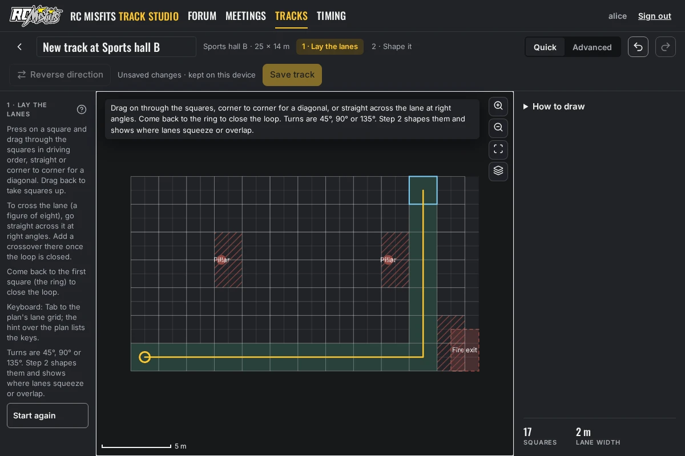

5. Bring the lane back to the first square, the one with the ring. The loop closes and the designer moves on to step 2, **Shape it**.

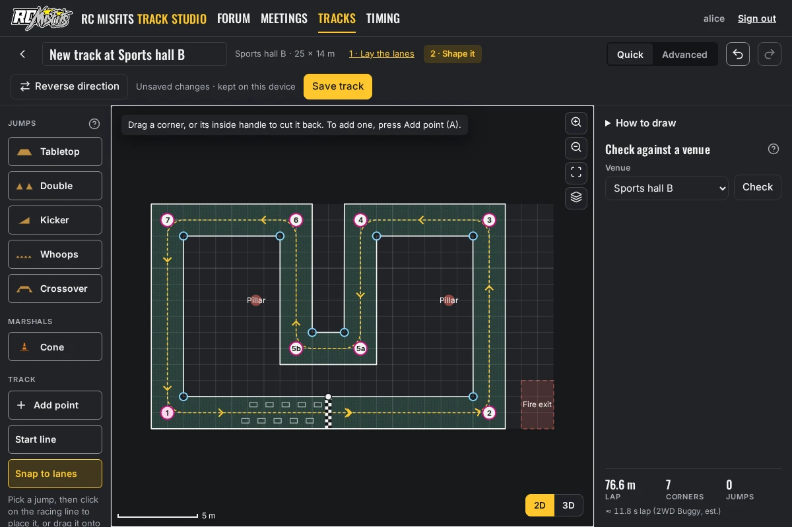

What you see now:

- The **lanes** are green and the **pipes** are the white lines.
- The dashed line is the **racing line**. Its arrows show the direction of travel.
- Each **corner** has a numbered dot. Corners are numbered the way racers count them, so a hairpin's two dots are one corner: **5a** and **5b**. The build sheet and the **Corners** figure use the same numbers.
- The chequered line is the **start line**, with the grid boxes behind it.

To take the whole lane up and begin again, use **Start again** in step 1.

In Quick mode, you can go back from step 2 while you are still on the loop you have just laid. Select **1 · Lay the lanes**, then select it again to confirm. The shaping you have done is thrown away. **Undo** brings it back.

You can also lay the lanes from the keyboard. Press <kbd>Tab</kbd> until the grid is selected. The arrow keys move the cursor, and <kbd>Enter</kbd> or <kbd>Space</kbd> starts the lane there. Then the arrow keys lay a square at a time, <kbd>Shift</kbd> with two arrows in turn lays a diagonal, and <kbd>Backspace</kbd> takes back the last square.

### Corners

1. Select a corner's numbered dot. Its panel opens on the right.

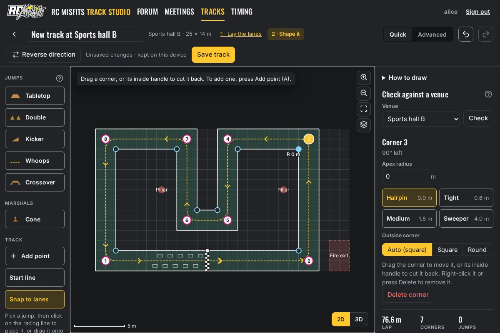

2. Drag the dot to move the corner.
3. To make the corner more open, choose a preset under **Apex radius**: **Hairpin** (0 m), **Tight** (0.6 m), **Medium** (1.8 m) or **Sweeper** (4 m). Or type a radius, or drag the corner's **inside handle**, the blue dot on the inside pipe.

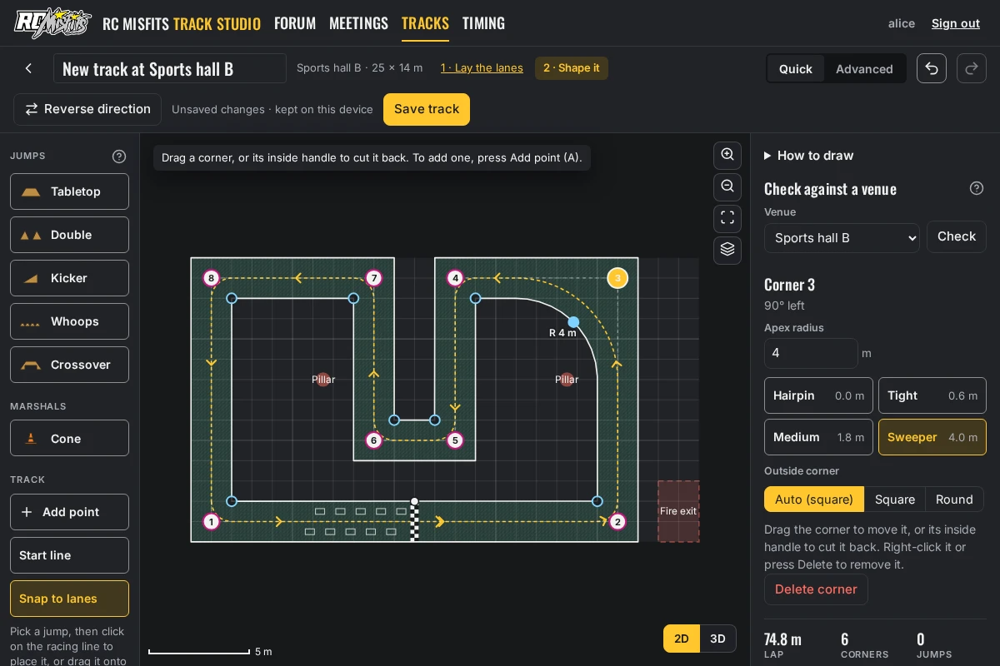

The numbers follow the track as you shape it. Here the sweeper runs straight into the next corner, so the two now count as one corner, **3a** and **3b**, and the corners after them move down a number.

4. **Outside corner** sets the outside pipe: **Square** is two straight pipes meeting in a corner, **Round** follows the curve. **Auto** uses square up to a 120° turn and round beyond.

To remove a corner, select it and press <kbd>Delete</kbd>, right-click it, or use **Delete corner** in its panel. A track needs at least 3 corners.

### Hairpins

A hairpin is a U-turn: the track comes back alongside itself, one lane over.

- **While laying the lanes**, turn back on yourself to make one. In the first picture above, the dots **5a** and **5b** are a hairpin: one corner, drawn as two points.
- **In Advanced mode**, you can turn any corner into a hairpin. Select the corner point and press <kbd>H</kbd>. On a phone, use **Make hairpin** in the corner's sheet. The corner becomes two points one lane apart.

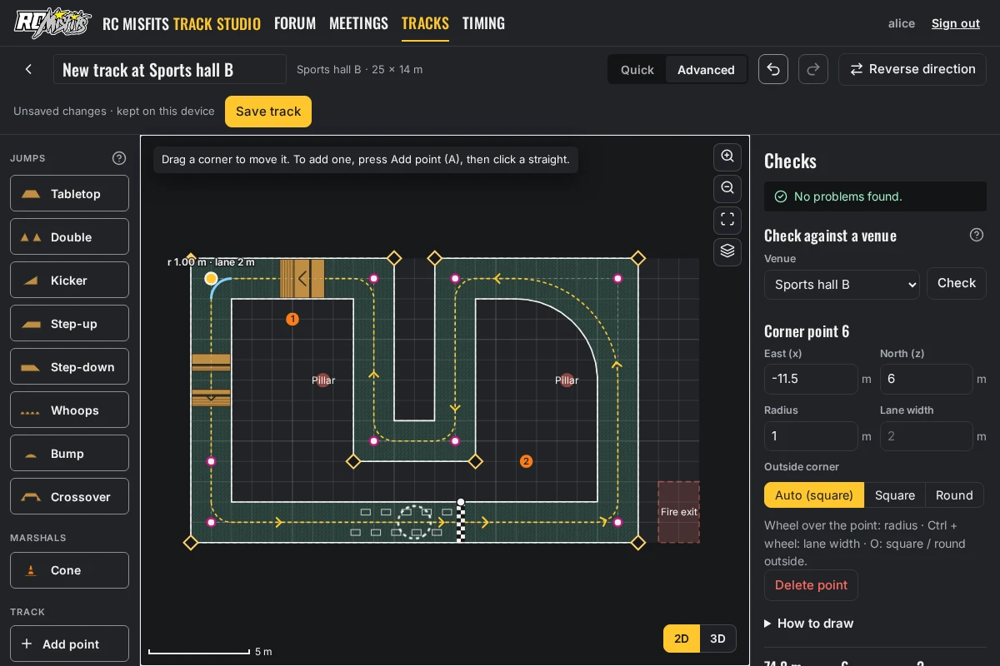

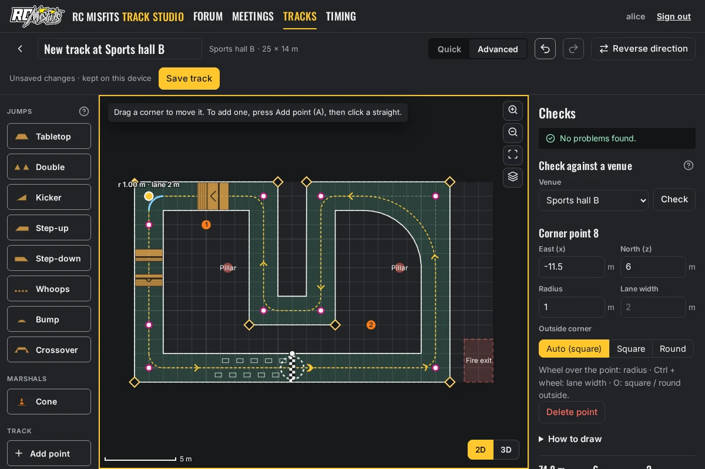

Make hairpin does nothing, and says why, on a point that is on a straight, or where there is no room for a second point.

### Straights

A straight is the run between two corners. There is no separate straight tool.

- To make a straight longer or shorter, move the corner at either end.
- To put a bend in a straight, add a corner to it, as below, and drag the new corner.

### Add a corner

1. Select **Add point** in the tools column, or press <kbd>A</kbd>.
2. Click the track where you want the new corner, or click the floor to add one after the selected corner. In Advanced mode, click a straight.
3. Add point stays on, so you can add several. Press <kbd>A</kbd> or <kbd>Esc</kbd> to stop.

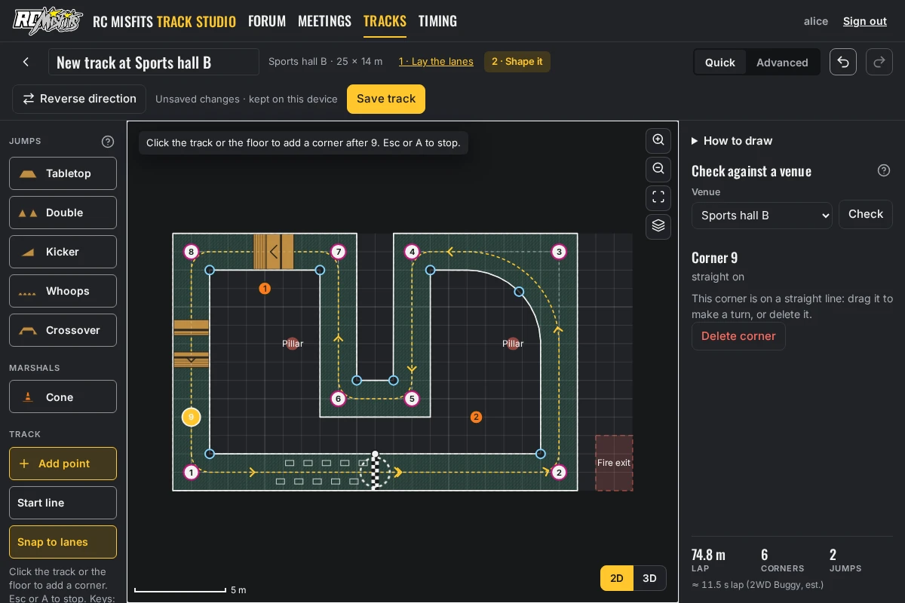

A new corner on a straight does nothing until you drag it to make a turn. Until then it isn't a corner, so its dot has no number.

### Jumps and ramps

The tools column lists the jumps: **Tabletop**, **Double**, **Kicker** and **Whoops**. Advanced mode adds **Step-up**, **Step-down** and **Bump**.

There are two ways to place one.

**Pick, then click:**

1. Select the jump in the tools column. It stays highlighted.

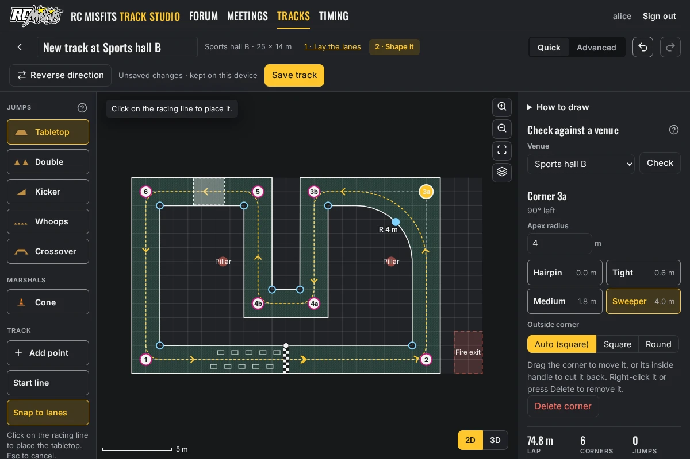

2. Click the racing line where the jump should go.

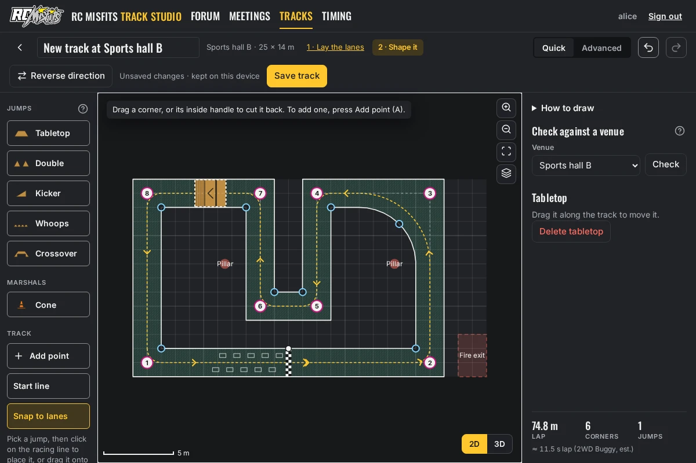

**Or drag it:** press on the jump in the tools column and drag it onto the track. Let go where you want it.

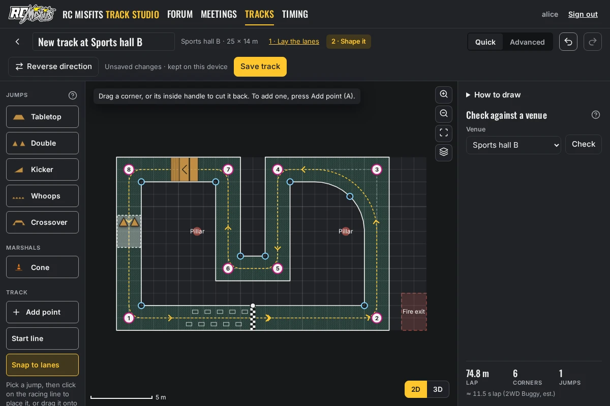

Then:

- **Move** a jump by dragging it along the track.
- **Remove** it by selecting it and pressing <kbd>Delete</kbd>, or with the **Delete** button in its panel.
- **Change its size** in Advanced mode: select it and set its type, how far along the lap it is, its length and its height. Leave length and height empty for the usual size.

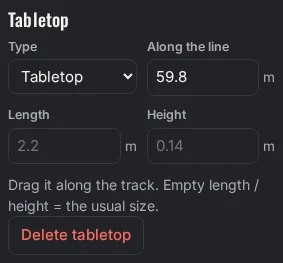

On a tablet the jumps are on the dock along the bottom. On a phone they are in the **Jump** sheet. See [On a tablet or phone](#on-a-tablet-or-phone).

### Crossovers

If the lane crosses itself, as in a figure of eight, the crossing needs a bridge.

1. In step 1, lay the lane straight across itself, at right angles.

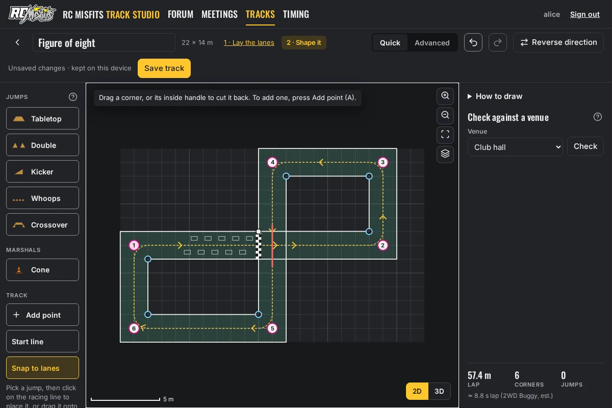

2. In step 2, select **Crossover** in the tools column.
3. Click the crossing. The pass you click goes over the top.

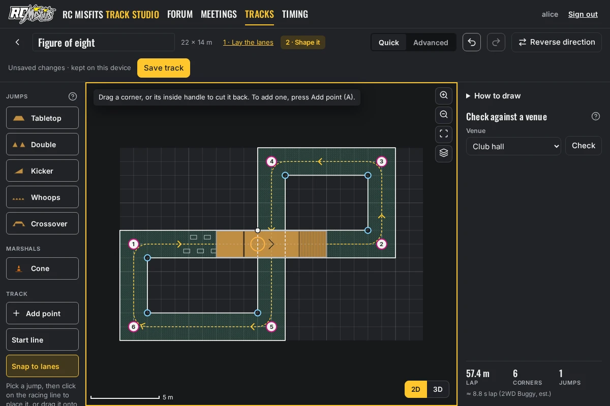

A crossing with no bridge is an error, and the layout cannot be submitted until it has one.

### Marshal cones and points

A cone marks where a marshal stands. Each cone has a number: the order the marshal points are filled. With three marshals, cones 1, 2 and 3 are manned.

1. Select **Cone** in the tools column.
2. Click where the marshal should stand: beside the track, or up to 2 m outside the track area. Or drag a cone from the tools column onto the plan.
3. To change its number, select the cone and use **−** and **+** under **Cone number**.

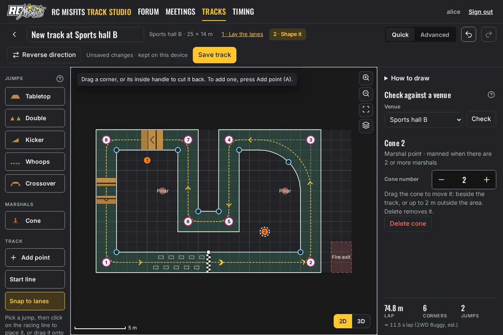

Drag a cone to move it. Select it and press <kbd>Delete</kbd> to remove it.

### The start line and the timing loop

Every layout has one start line. It is the start and the finish.

1. Select **Start line** in the tools column. The plan zooms in on the line.
2. Drag the line along the track. The grid boxes move with it.
3. Cars start towards the arrow.

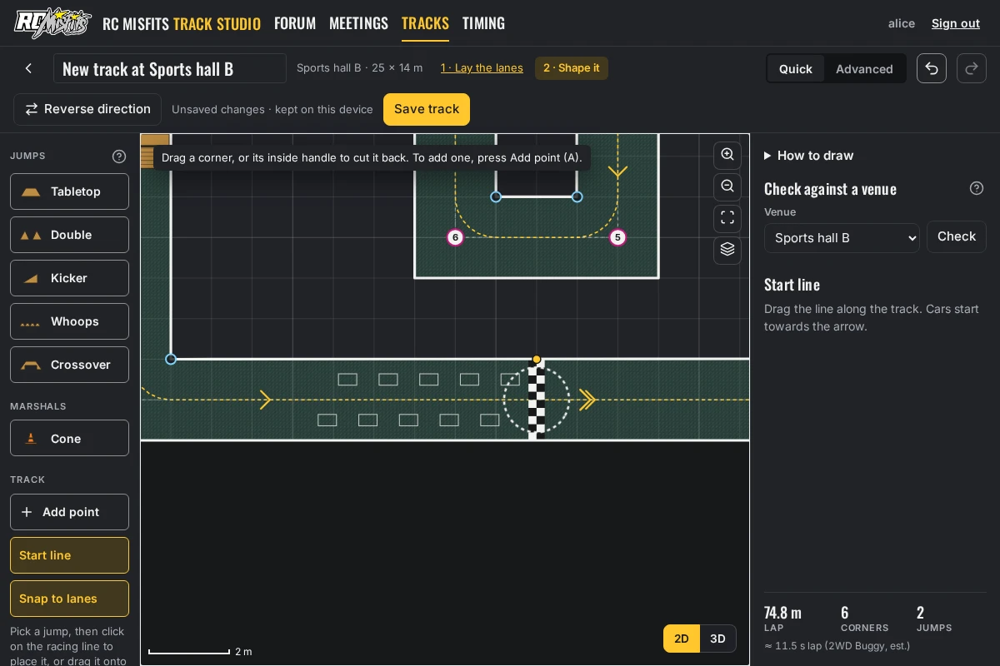

When you let the start line go (press Escape, click the floor, or on a phone close its sheet), the plan zooms back to where it was. If you zoomed or moved the plan yourself meanwhile, it stays where you put it.

The start line is where a lap begins and ends, and it is the timing line in the sim. Put the start line where your club's timing loop goes.

If the venue template has a timing loop, the plan shows it as a dashed orange line with an arrow for the way the track runs. Put the start line over it, running the arrow's way. The fit check warns when it isn't. See [The fit check](#the-fit-check).

### The rostrum

The rostrum belongs to the hall, not to the layout. Each venue template says which side the rostrum is on: north, south, east or west.

You see the rostrum in three places:

- On the **New track** page and the **Venues** page, each hall says "rostrum north", "rostrum south" and so on.
- The **fit check** tells you which side it is on. See [The fit check](#the-fit-check).
- In **3D**, the **Rostrum** buttons (**N**, **E**, **S**, **W**) show the track as drivers will see it from that side.

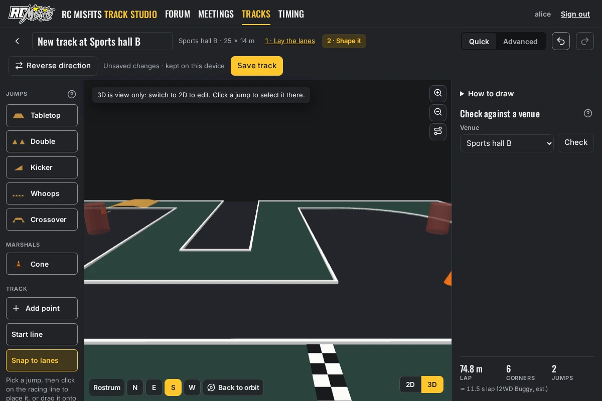

To move a hall's rostrum, the club's committee or an organiser edits the venue template.

## Edit

### Select

Click a corner, a jump, a cone or the start line to select it. Its panel opens on the right, with its settings and a Delete button. The start line has no Delete: a track always has one.

Press <kbd>Esc</kbd> to select nothing.

### Move

Drag what you selected.

- **Corners** go wherever you drag them. With **Snap to lanes** on, a corner snaps to a lane line when it is within 0.2 m, which keeps lanes tidy against the walls and each other. Hold <kbd>Alt</kbd> to place it freely.
- **Jumps and the start line** slide along the track.
- **Cones** go anywhere beside the track.

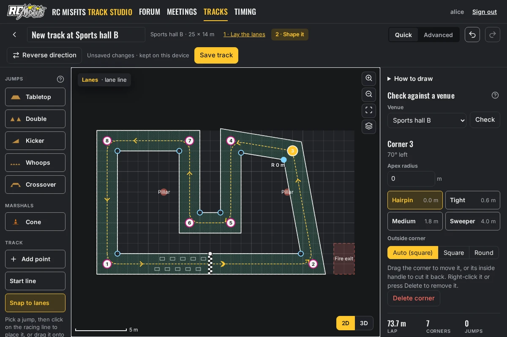

### Rotate and headings

You do not rotate things by hand in Track Studio.

- **Jumps and the start line** always face the direction of travel.
- **Reverse direction** runs the whole layout the other way round. The start line and jumps stay where they are and turn to face the new way.

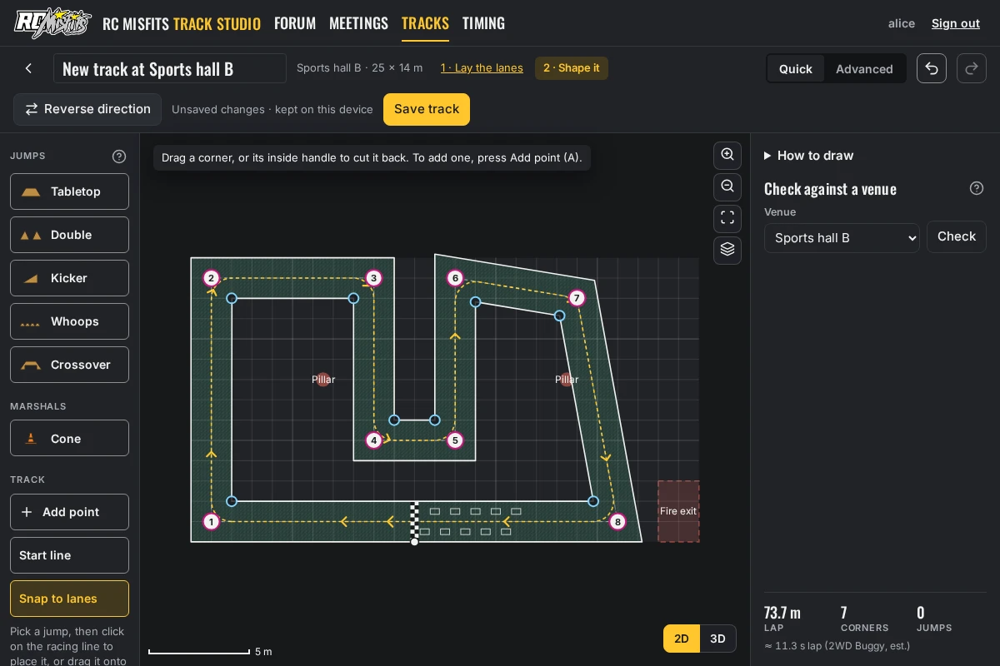

- **To turn or mirror a whole layout** so that it fits a hall, use **Fit to a venue**. See [The fit check](#the-fit-check).

### Undo and redo

The two arrow buttons at the top are **Undo** and **Redo**. From the keyboard, use <kbd>Ctrl</kbd>+<kbd>Z</kbd> to undo and <kbd>Ctrl</kbd>+<kbd>Shift</kbd>+<kbd>Z</kbd> to redo.

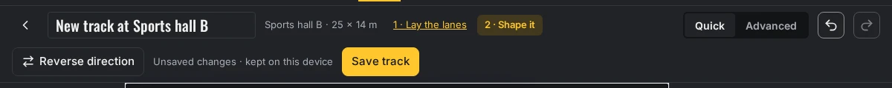

Until you save, the bar says **Unsaved changes · kept on this device**. If you close the page by accident, open the layout again on the same device. The designer says you have unsaved changes: select **Restore them** to carry on, or **Discard** to drop them.

### Quick and Advanced

The designer has two modes. Switch with **Quick** and **Advanced** in the top bar. You can go back and forth as often as you like.

| | Quick | Advanced |
|---|---|---|
| For | Getting a layout drawn | Exact sizes and the full checks |
| Corners | Drag, cut back with the inside handle, four presets | Type a position, radius and lane width for each corner point |
| Jumps | Tabletop, double, kicker, whoops, crossover | Also step-up, step-down and bump, with a length and height |
| Snapping | Snap to lanes, on or off | **Lanes**, **Fine** (a 25 cm grid and 45° angles) or **Free** |
| Checks | Errors hold back Submit | The full list, with a **Show** button for each |

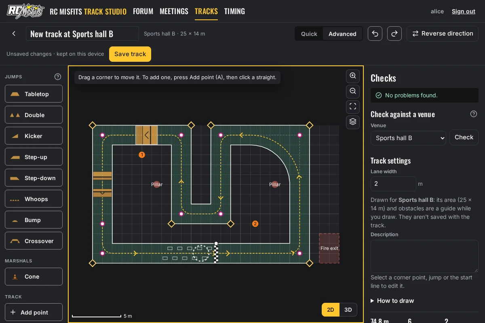

In Advanced mode:

- Corners are drawn as **corner points**. The small dot is on the racing line. The diamond is the outside corner of the pipes.
- Select a corner point to type its **East** and **North** position, its **Radius** and its **Lane width**.
- With nothing selected, **Track settings** has the **Lane width** for the whole layout and a **Description**.
- Roll the mouse wheel over a corner point to change its radius. Hold <kbd>Ctrl</kbd> and roll to change its lane width.

### The Advanced selection sheet

On a phone, the panel for what you selected is a sheet that slides up from the bottom. In Advanced mode, a corner point's sheet has its position, radius, lane width, outside corner and **Make hairpin**.

Pull the bar at the top of the sheet upwards to see all of it. Pull it down, or select **×**, to close it.

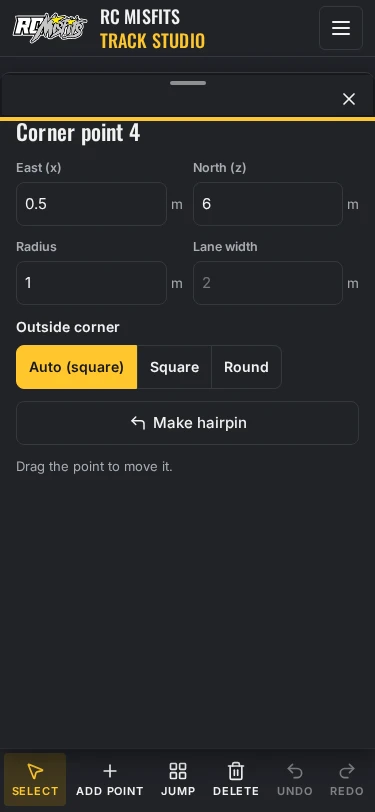

### The context sheet

On a phone, hold your finger on a corner, a jump, a cone or the start line for about half a second. A short list opens with what you can do to it:

- **Delete**
- **Round outside corner** or **Square outside corner**, for a corner
- **Make hairpin**, for a corner point in Advanced mode
- **Change number**, for a cone

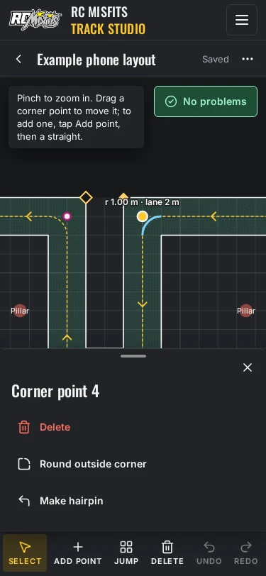

If something cannot be done, its row is greyed out and says why. For example, the start line cannot be deleted, because a track always has one.

With a keyboard attached, the list has these keys:

| Key | What it does |
|---|---|
| <kbd>↑</kbd> <kbd>↓</kbd> | Move up and down the list |
| <kbd>Home</kbd> <kbd>End</kbd> | Jump to the first or last row |
| <kbd>Enter</kbd> | Do the highlighted row |
| <kbd>Esc</kbd> | Close the list |

### Keyboard shortcuts

These work in the designer on a computer.

| Key | What it does |
|---|---|
| <kbd>Ctrl</kbd>+<kbd>Z</kbd> | Undo |
| <kbd>Ctrl</kbd>+<kbd>Shift</kbd>+<kbd>Z</kbd> | Redo |
| <kbd>Ctrl</kbd>+<kbd>S</kbd> | Save |
| <kbd>A</kbd> | Add point, on or off |
| <kbd>N</kbd> / <kbd>P</kbd> | With Add point on: pick the next or previous corner |
| <kbd>Enter</kbd> | With Add point on: add a corner halfway to the next one |
| <kbd>Delete</kbd> or <kbd>Backspace</kbd> | Delete what is selected |
| <kbd>Esc</kbd> | Stop the current tool and select nothing |
| <kbd>O</kbd> | Switch the selected corner between a square and a round outside |
| <kbd>H</kbd> | Advanced: make the selected corner point a hairpin |
| <kbd>+</kbd> <kbd>−</kbd> <kbd>0</kbd> | Zoom in, zoom out, fit to view |
| <kbd>Alt</kbd> while dragging | Place a corner freely, without snapping |
| <kbd>Shift</kbd> while dragging | Advanced: snap to the 25 cm grid |

## Check and finish

### The checks

Track Studio checks the layout as you draw.

- In **Quick** mode, an error stops you submitting, and the bar says what to fix.
- In **Advanced** mode, the **Checks** panel on the right lists everything.
- On a phone, or a tablet in Quick mode, select the checks pill, top right of the plan.

Select **Show** beside a check to zoom to the spot.

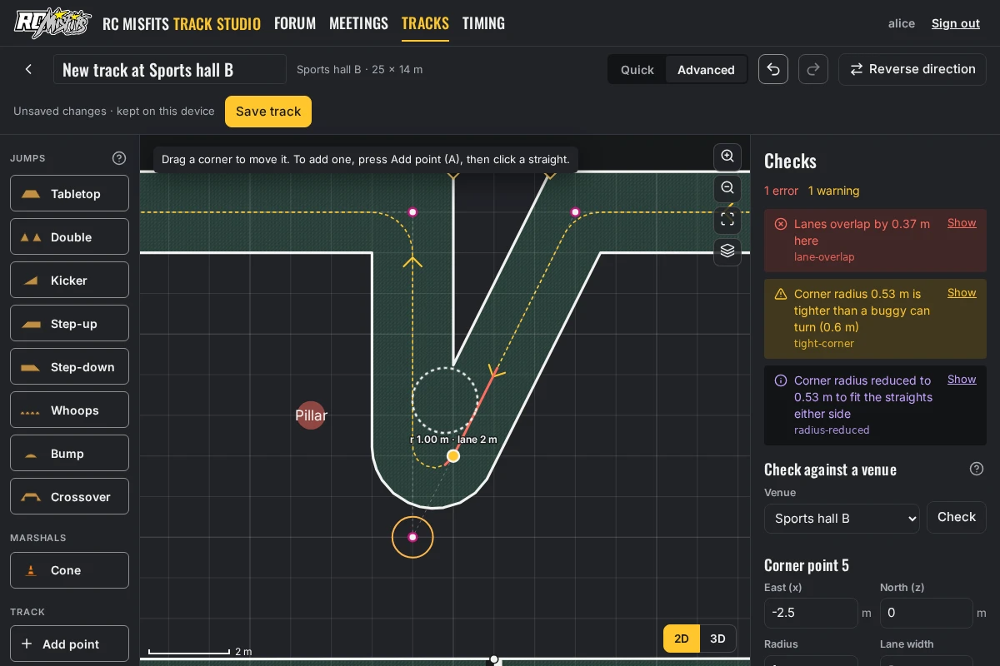

There are three kinds:

- **Errors** (red) must be fixed before the layout can be submitted.
- **Warnings** (amber) are worth a look, but do not stop you.
- **Notes** (grey) are for information.

What the common ones mean:

| Check | Kind | What it means | What to do |
|---|---|---|---|
| Lanes overlap by … m here | Error | Two lanes are drawn on top of each other | Move one of the corners nearby until the lanes sit side by side |
| Track crosses itself … with no bridge | Error | The lane crosses itself without a crossover | Add a **Crossover** on the crossing |
| Cone … is on the track | Error | A marshal point is in a lane | Drag the cone off the track |
| Lane narrows by … m at this corner | Warning | The lane is squeezed at a corner | Open the corner out, or move it |
| Corner radius … is tighter than a buggy can turn | Warning | Cars cannot get round without stopping | Give the corner a bigger radius, or more room |
| Start line is on a ramp | Warning | The start line is on a jump | Slide the start line or the jump along |
| Two cones are numbered … / No cone … | Warning | The cone numbers repeat or skip | Renumber the cones |
| … is on or lands into a corner | Note, or a warning for a crossover | A jump is in a corner: a technical section | Nothing, if you meant it. Move a crossover clear of the corner |
| Corner radius reduced to … | Note | The radius you asked for did not fit between the straights | Nothing, or move the corners apart |

### The fit check

The fit check answers one question: does this layout fit that hall? It compares the layout with a venue template: the hall's track area, its fixed obstacles and its timing loop. A pit area or a rostrum marked inside the hall counts as a fixed obstacle: the layout has to keep off it.

The **?** beside the heading opens this part of the guide.

#### While you draw: Check against a venue

1. In the designer, find **Check against a venue** on the right. On a tablet or phone it is under the checks pill.
2. Choose the **Venue**.
3. Select **Check**.

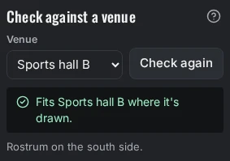

The answers, and what they mean:

| Answer | What it means |
|---|---|
| **Fits … where it's drawn.** | Nothing to do. It fits the hall as it is. |
| **Fits … once moved: as designed, mirrored, rotated 180 …** | It does fit the hall, but not where it is drawn now. The list says which ways round it fits. |
| **Where it's drawn: the track overlaps a fixed obstacle.** | A lane runs over a pillar or another obstacle. Select **Show** to see where. |
| **Where it's drawn: the track goes outside the venue's track area.** | Part of the layout is beyond the edge of the usable area. Select **Show** to see where. |
| **Where it's drawn: start/finish isn't over the timing loop.** | A warning. The start line is not on the hall's timing loop. Move the start line onto the loop, running the arrow's way. Select **Show** to see the loop. |
| **Where it's drawn: start/finish runs the wrong way over the timing loop.** | A warning. The start line is on the loop, but cars would cross it against the arrow. Move the start line to a lane that runs the arrow's way, or use **Reverse direction**. |
| **Where it's drawn: start/finish crosses the timing loop at an angle.** | A warning. The start line is on the loop but more than 30° off its direction. Move it to a straight that runs the arrow's way. |
| **Doesn't fit … in any orientation.** | It is too big for this hall, or cannot avoid the obstacles, whichever way round it goes. Make it smaller or pick another hall. |
| **Rostrum on the … side.** | Where this hall's rostrum is, for the layout as drawn. |
| **The track has changed since: check again.** | You have edited the layout since the last check. Select **Check** again. |

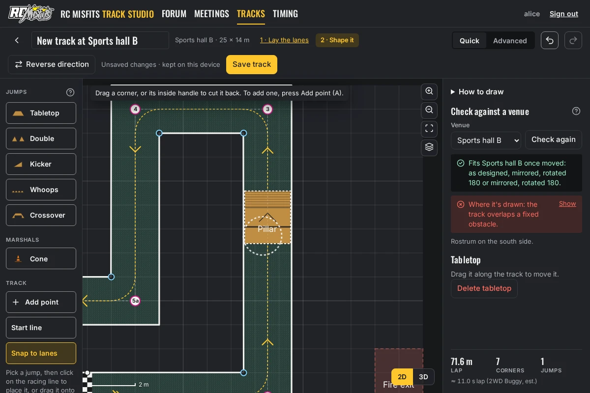

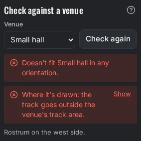

The check does not change your layout and nothing from the venue is saved with it.

#### On a layout's page: Fit to a venue

Use this to take a finished layout to a different hall.

1. Open the layout's page and select **Fit to a venue**.
2. Choose the **Venue**.
3. Under **Fits as**, choose a way round. Each one says how much room is spare.
4. The preview shows the layout placed in the hall, with the hall's obstacles, rostrum and timing loop. If that way round leaves the start line off the loop, a **Timing loop** warning under the preview says so: pick another way round, or move the start line in your copy.

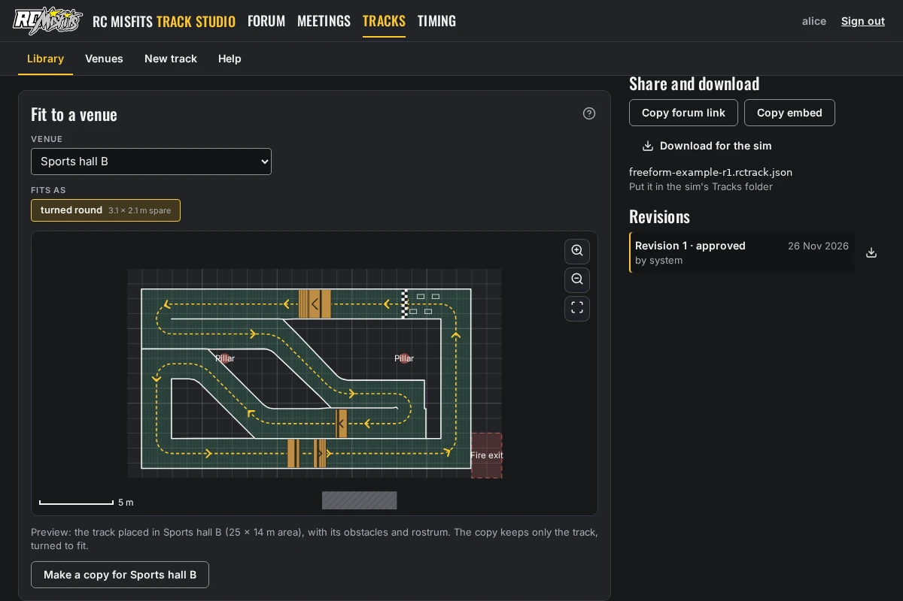

5. Select **Make a copy for …** to get your own copy, turned to fit that hall. The original is not changed, and your copy stays credited to it.

If no way round fits, the panel says so.

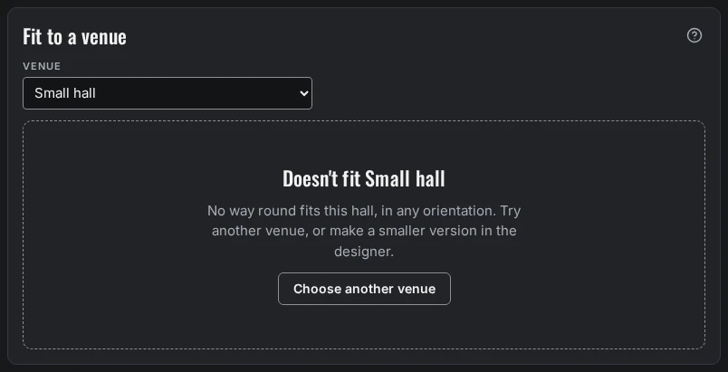

In the library, the **Fits my venue** filter runs the same check across every approved layout.

### Lap length and estimated lap time

The designer shows the figures bottom right, and they update as you draw.

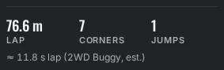

- **Lap** is the length of the racing line.
- The **estimated lap time** comes from the lap length and a typical speed for the class. It is a guide, not a promise.

A layout's page shows an estimate for every class. Once the layout has been raced and the results are published on the forum, the page shows real figures instead: the typical lap, the lap record and the best three consecutive laps for each class.

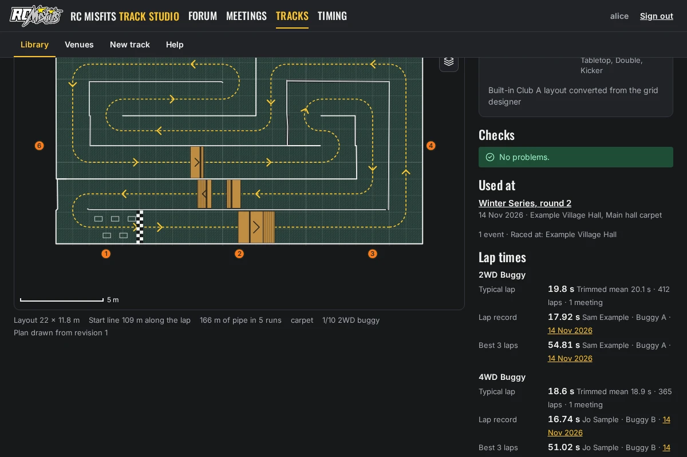

Organisers set the class speeds behind the estimates on the **Lap speeds** page.

### The 3D preview

Select **3D** to see the layout as it will stand: pipes, jumps, cones and the hall's obstacles. Select **2D** to go back.

- In the **designer**, the switch is bottom right of the plan. 3D is for looking only: go back to 2D to edit.

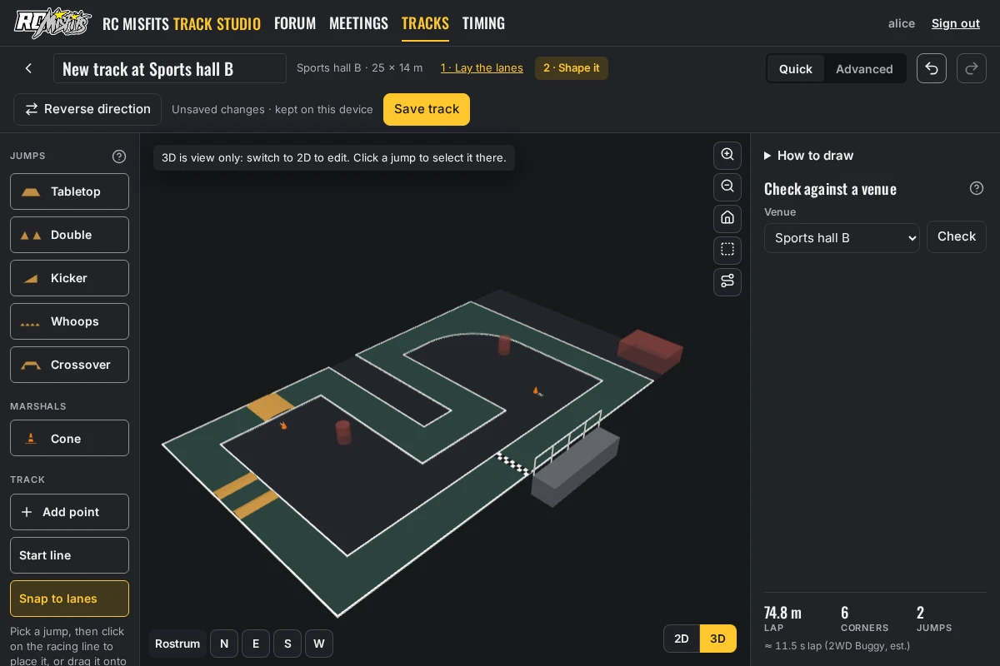

- On a **layout's page**, the switch is top left of the plan.

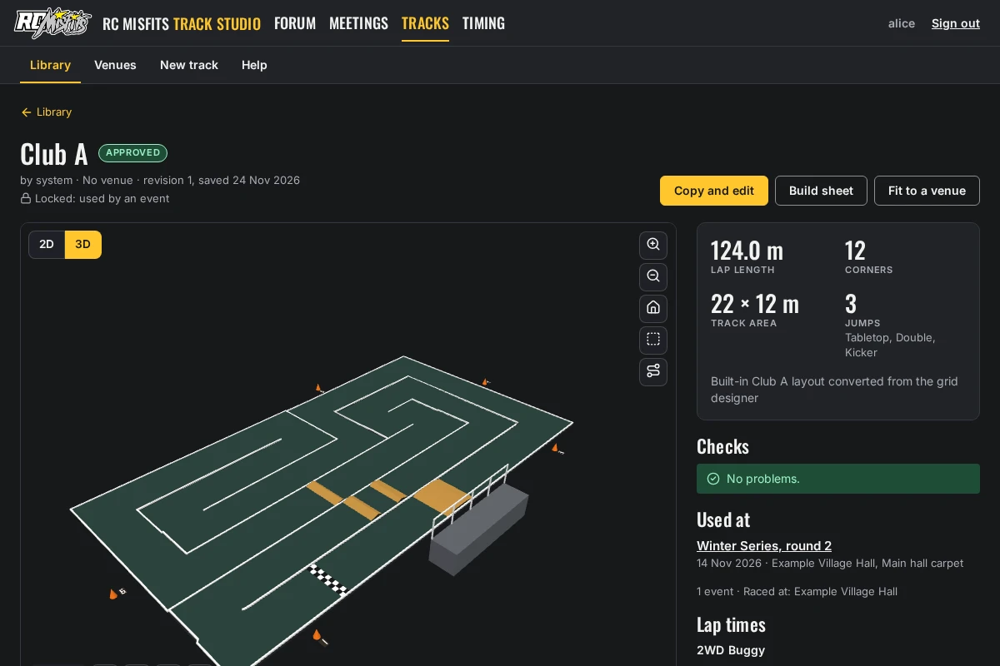

To look around:

| To | Mouse | Touch | Keys |
|---|---|---|---|
| Turn the view | Drag | Drag with one finger | <kbd>Shift</kbd> and the arrow keys |
| Move the view | Right-drag | Drag with two fingers | Arrow keys |
| Zoom | Wheel | Pinch | <kbd>+</kbd> and <kbd>−</kbd> |
| Start again | **Reset view** button | **Reset view** button | <kbd>0</kbd> |

The buttons on the plan also give a **Top view**, show or hide the **Racing line**, and put you on the **Rostrum** on any side.

### The build sheet

The build sheet is the page you print and take to the hall.

1. Open the layout's page and select **Build sheet**.
2. Choose **A3 landscape** or **A4 landscape**.
3. Select **Print or save as PDF**.

The **Help** button on the build sheet opens this part of the guide.

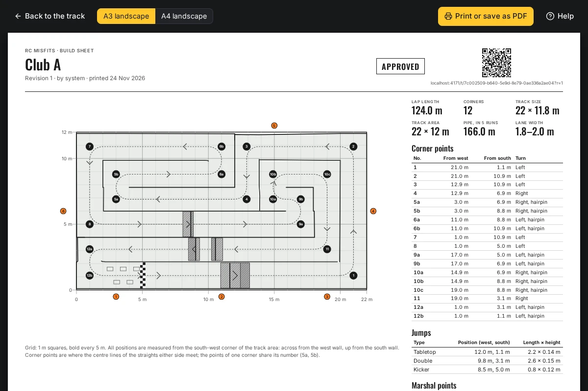

What is on it:

- **The plan**, on a grid of 1 m squares with a bold line every 5 m, and every corner point numbered.
- **Corner points**: how far each one is from the west wall and from the south wall, and which way it turns. Measure from the south-west corner of the track area. The points of one corner share its number, such as 5a and 5b. These are the same numbers as the dots in the designer.
- **Jumps**: the type, where it goes, and its length and height.
- **Marshal points** and the **start line**, with their positions.
- **The figures**: lap length, corners, track size, track area, how much pipe in how many runs, and the lane width.
- **The status**. A layout that is not approved yet is stamped as a draft.
- **A QR code and a link** back to exactly the revision you printed.

The sheet is laid out for A3. Print it from a computer, or save it as a PDF and print that.

## Share

### Save

1. Select **Save track** in the designer's top bar.
2. Type a short note about the layout under **What changed?** if you like.
3. Select **Save track**.

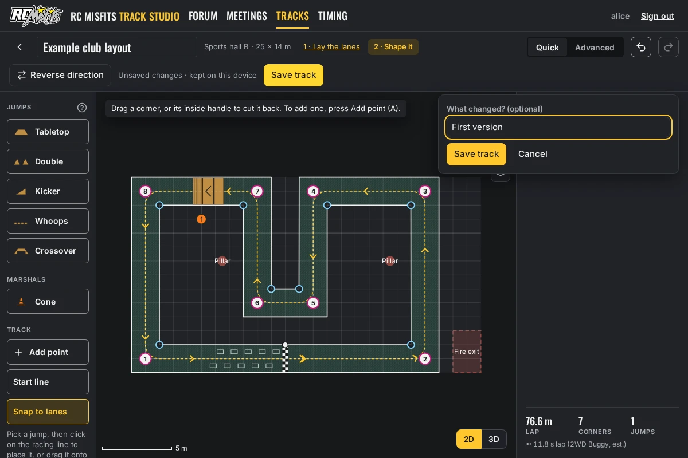

The layout is now in the library as a **draft**, where only you and the organisers can see it. The bar shows **Saved · revision 1**.

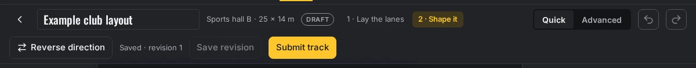

### Revisions

Every save after the first makes a new **revision**. Earlier revisions are kept, so nothing is lost.

1. Change the layout.
2. Select **Save revision**, or press <kbd>Ctrl</kbd>+<kbd>S</kbd>.
3. Say what changed, then select **Save as revision 2**.

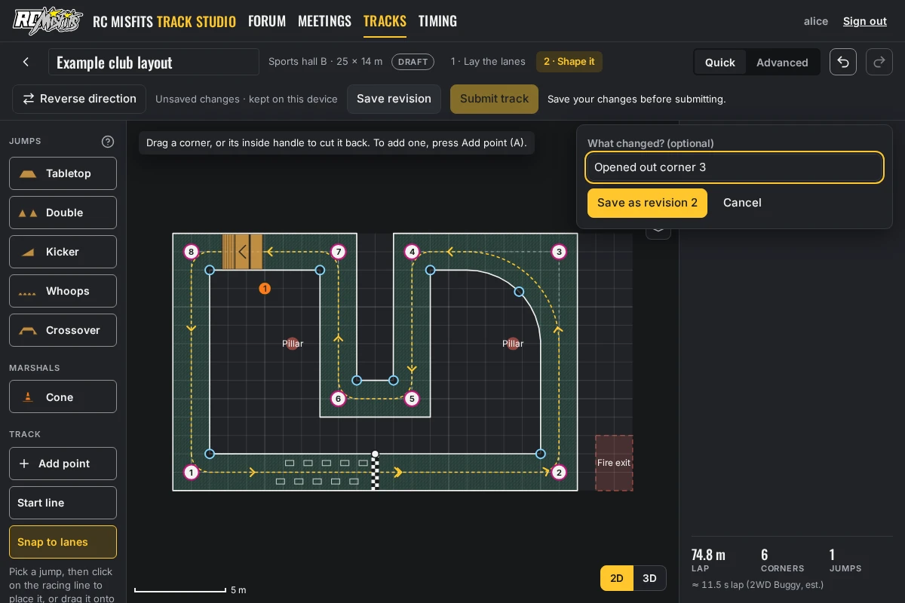

The layout's page lists its **Revisions**, newest first, with who saved each one and the note. Select a revision to look at it. The arrow beside it downloads that revision.

### Publish: draft, submitted, approved

A layout moves through four stages. Its badge shows which one it is at.

| Stage | What it means | Who moves it on |
|---|---|---|
| **Draft** | Work in progress | You, with Submit |
| **Submitted** | Waiting for an organiser to look at it | An organiser, with Approve |
| **Approved** | In the library for clubs to use | |
| **Archived** | Retired. It is hidden from the library unless you select **Archived** under Status | An organiser, with Archive |

**To submit a layout:**

1. Save it. Fix any errors: Submit is held back until there are none.
2. Select **Submit track** in the designer, or **Submit revision …** on the layout's page.

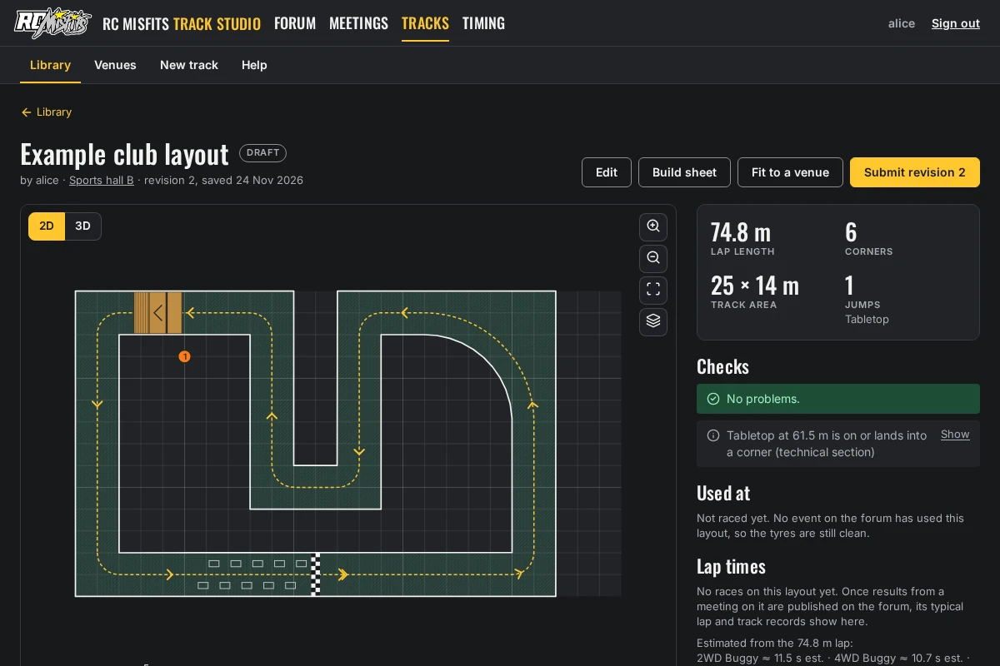

The badge changes to **Submitted**.

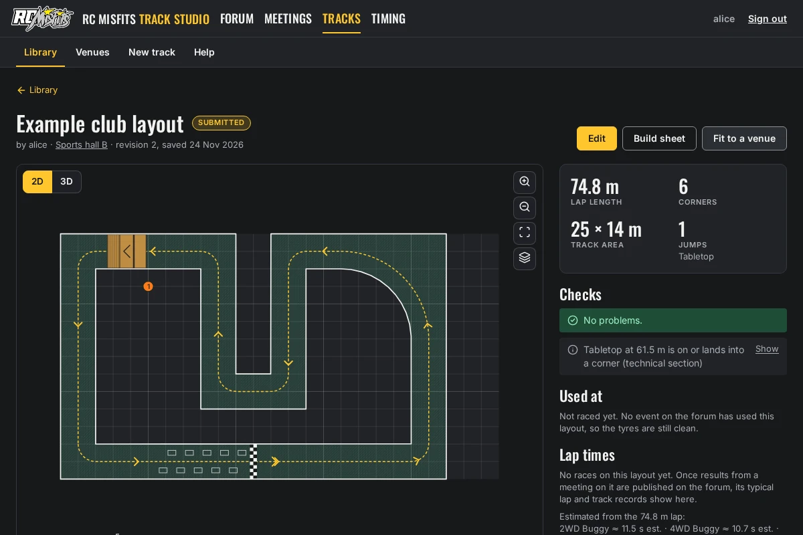

**Organisers** see two more buttons: **Approve revision …** on any layout whose newest revision is not approved yet, and **Archive** on every layout.

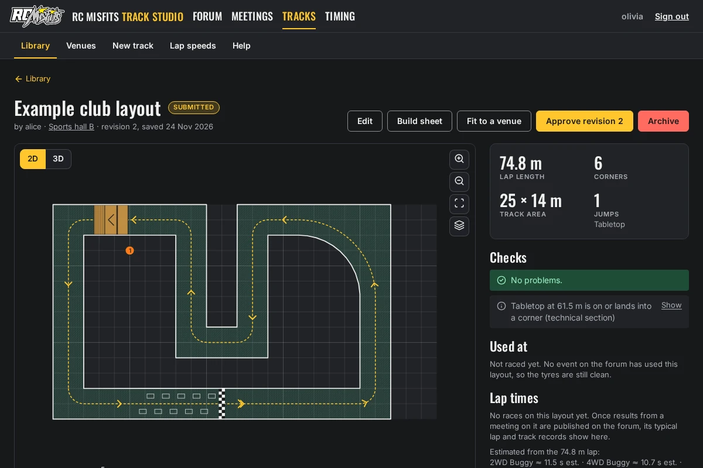

Once approved, the layout is **locked**. Nobody can change an approved layout, so a club that builds it gets what was approved.

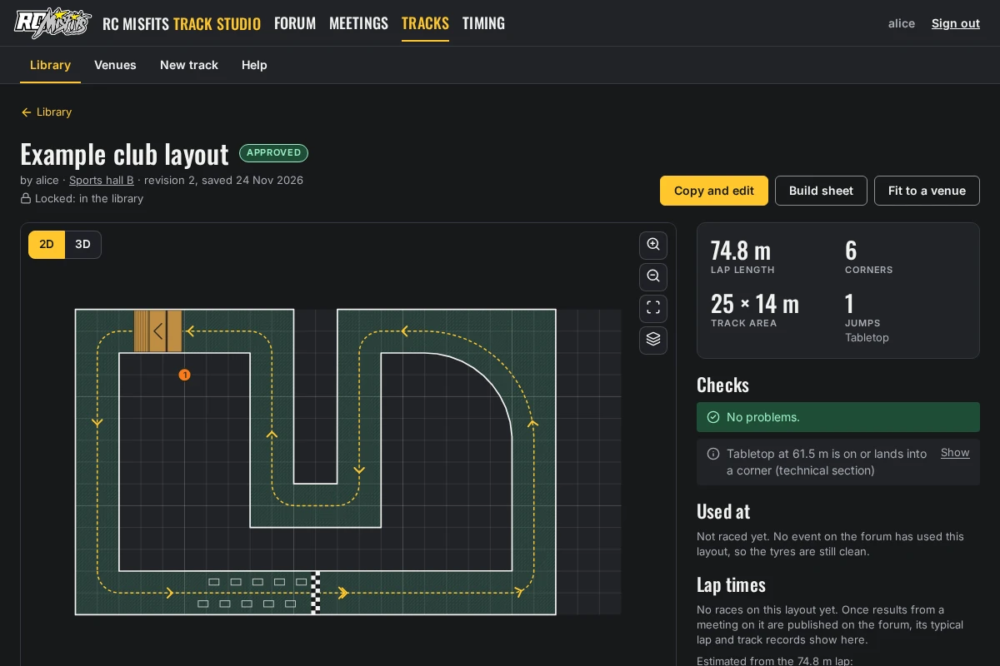

To change an approved layout, select **Copy and edit**. You get your own draft copy, credited to the original.

### Public and private layouts

A **draft** is private: only you and the organisers can see it. It isn't in the library for anyone else, and its link shows "Not found" to them. When you **Submit** it, it becomes public; submitted and approved layouts can be seen by anyone, signed in or not. If you edit a submitted layout it is a draft, and private, again until you submit it. A layout a meeting uses is always public. An archived layout that was never approved stays private.

Only the author and organisers can edit a layout. Any other signed-in member is offered **Make my own copy** of a public one.

### Voting

Voting happens on the forum, not in Track Studio. Track Studio itself has no voting.

A meeting can let its racers vote between layouts:

1. On the forum, the organiser opens the meeting's **Event Manage** and its **Details** tab. In the **Vote for the track** panel they offer up to 4 layouts and set a closing time, which must be before the meeting starts.
2. Racers booked on the meeting vote on the forum. They can change their vote until the closing time.
3. At the closing time, the layout with the most votes becomes the meeting's layout. This happens by itself, and the voters are told.

The organiser picks the layout only if the vote is tied or nobody voted, or to end the vote early.

The steps for organisers are in the forum's club guide, [Set up the club's venue template in Track Studio](https://forum.rcmisfits.org/t/external_id/club-guide-track-studio-venue-template), under "Attach a layout to a meeting".

The winning layout shows in Track Studio like any other meeting's layout: see [Attach a layout to a meeting](#attach-a-layout-to-a-meeting).

### Put a layout on the forum

On the layout's page, find **Share and download**.

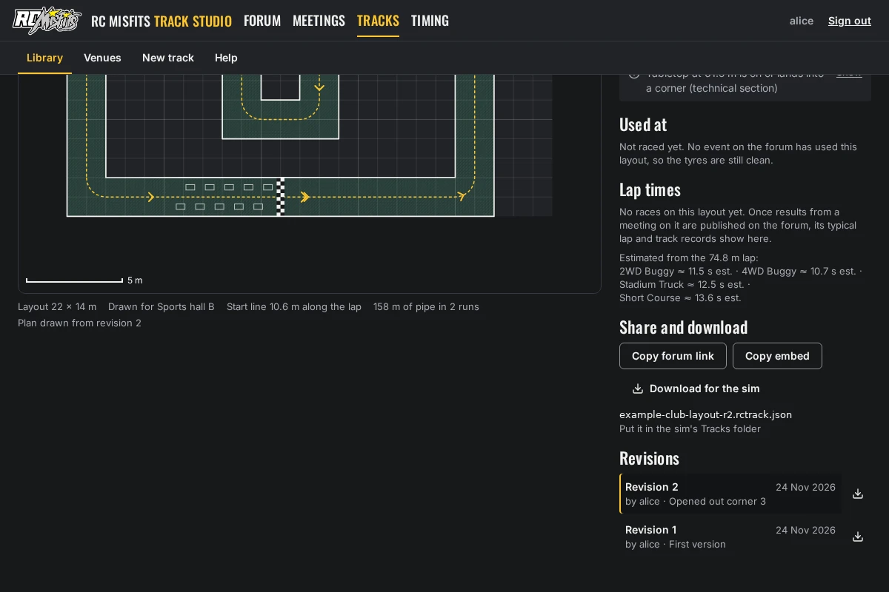

- **Copy forum link** copies the layout's address. Paste it on a line of its own in a forum post and the forum shows a preview card, with the plan and the figures.
- **Copy embed** copies a snippet that shows the layout's viewer inside another web page.

### Attach a layout to a meeting

Meetings are set up on the forum, not in Track Studio. The organiser chooses the layout when setting up the meeting on the forum, or lets the booked racers vote between up to 4: see [Voting](#voting). The steps are in the forum's club guide, [Set up the club's venue template in Track Studio](https://forum.rcmisfits.org/t/external_id/club-guide-track-studio-venue-template), under "Attach a layout to a meeting".

In Track Studio you see the result:

- The layout's page lists the meetings under **Used at**.
- A layout that a meeting uses is locked, like an approved one: **Locked: used by an event**.
- After the results are published, the lap times appear on the layout's page.

### Download for the sim

1. On the layout's page, select **Download for the sim**.
2. Put the downloaded file in the sim's **Tracks** folder. The file's name ends in `.rctrack.json`.

The download is the revision you are looking at. For an approved layout, that is the approved revision.

### The "latest" link

There is also an address that always gives the current public revision of a layout: the approved one, or the newest if none is approved yet. For a draft it works only for its author and the organisers. It is useful for a link that should keep working after the layout is revised.

Take the layout's page address, for example `https://tracks.rcmisfits.org/t/1234abcd`. The part after `/t/` is the layout's id. The latest link is:

`https://tracks.rcmisfits.org/api/tracks/1234abcd/latest.rctrack.json`

There is no button for this link yet. You have to build it by hand.

## On a tablet or phone

Track Studio works with fingers as well as a mouse. This section says what works on touch today and what is still being built.

| | Tablet | Phone |
|---|---|---|
| Library, layout pages, 3D, build sheet | Yes | Yes |
| Lay the lanes (step 1) | Yes | **Not yet**: use a tablet or computer |
| Shape the track (step 2) | Yes | Yes, held upright |
| Save and submit | Yes | Yes |

### Pinch, pan and armed tools

These three things work the same on a tablet and a phone.

- **Pinch** with two fingers to zoom in and out.
- **Pan** by dragging an empty part of the plan with one finger. Two fingers on the plan always pan and zoom, and never draw.
- **Armed tools.** Tap a tool, such as a jump, a cone or **Add point**. It lights up: it is armed. Then tap the plan where it should go. Tap the tool again to put it down. On a phone you can also tap **Select**.

### On a tablet

In Quick mode, the tools are on a **dock** along the bottom, and the checks are behind a pill, top right of the plan. Switch to **Advanced** and a tablet shows the same layout as a computer, with the tools on the left and the panels on the right.

**Lay the lanes** with one finger: press on the first square and drag through the others, as with a mouse.

**Shape it** from the dock.

- **Drag** a corner to move it, or its inside handle to cut it back.
- **Tap a jump** on the dock to arm it, then tap the racing line. Or drag the jump from the dock onto the track.

- **Hold a corner** for its panel: the radius presets, the outside corner and Delete.

- **Tap the checks pill** for the checks and **Check against a venue**.

### On a phone

A phone can do everything except lay the lanes. Hold the phone upright: on its side, the designer asks you to turn it back.

The library and a layout's page are a single column.

**Starting a new layout** on a phone shows this message. Lay the lanes on a tablet or computer and save. After that you can open the layout on your phone.

**Editing a saved layout** works. Open the layout's page and tap **Edit**.

1. **Pinch to zoom in** first. Corners and their inside handles are close together when the whole track is on screen.

2. **Tap a corner** to select it. Its sheet slides up with the radius presets. Drag the corner to move it. A magnifier shows what is under your finger while you drag.

3. **Hold a corner** for the short list of actions. See [The context sheet](#the-context-sheet).

4. **Tap Jump** for the jumps, the cone, the start line and **Snap to lanes**.

5. **Tap a jump**, then tap the racing line. Or drag the jump from the sheet onto the track.

6. **Tap the checks pill** for the checks, the venue check and the figures.

7. **Tap ⋯**, top right, to save, submit, switch between Quick and Advanced, reverse the direction, zoom to fit, edit the layout's details, or open **How to draw**.

**How to draw**, on a computer and on a phone, has a link to this guide. A tablet in Quick mode has no link in the designer yet: open **Help** from the menu on any other page.

### What is coming on phones

Drawing a whole layout on a phone is being built now, in three parts:

- the **New track** page laid out for a phone;
- **laying the lanes** with a finger, on a zoomed-in grid;
- a **mini-map** so you can see the whole hall while you lay the lanes.

This section will be updated as each part arrives. Until then, start a layout on a tablet or computer.

The 3D view in the phone's designer is also still being finished. 3D on a layout's page works on a phone now.

## FAQ

### Do I need an account?

Not to look. You can browse the library, open any public layout, print its build sheet and read this guide without signing in. To save a layout you need to sign in with your RC Misfits forum account.

### How do I get my hall added?

Ask your club's committee or one of Track Studio's organisers. They add venue templates on the **Venues** page. Until your hall is there, use **Start blank** and type its size. See [Start blank](#start-blank).

### Can I draw before the venue template exists?

Yes. Start blank with the hall's track area. When the template is added, use **Check against a venue** to see whether your layout clears the hall's obstacles. See [The fit check](#the-fit-check).

### How do I undo a mistake?

Press <kbd>Ctrl</kbd>+<kbd>Z</kbd>, or select the **Undo** arrow. You can undo many steps. See [Undo and redo](#undo-and-redo).

### How do I delete a corner, jump or cone?

Select it and press <kbd>Delete</kbd>, or use the **Delete** button in its panel. On a phone, select it and tap **Delete** on the toolbar, or hold it and choose **Delete**.

### Why did clicking the plan not add a corner?

A plain click never adds a corner, so you cannot add one by accident. Turn on **Add point** first. See [Add a corner](#add-a-corner).

### Why can I not submit my layout?

The designer says why beside the Submit button. It is one of two things: you have changes you have not saved, or the checks have found an error. See [The checks](#the-checks).

### Why can I not edit a layout?

Either it is someone else's, or it is locked because it is approved or a meeting uses it. Select **Copy and edit** or **Make my own copy** to get a copy you can change.

### How do I change an approved layout?

Select **Copy and edit** on its page, change your copy, and submit it. See [Publish: draft, submitted, approved](#publish-draft-submitted-approved).

### How do I make a layout fit a different hall?

Open its page and select **Fit to a venue**. If it fits, **Make a copy for …** gives you a copy turned to suit. See [The fit check](#the-fit-check).

### How do I change the lane width?

Switch to **Advanced**. With nothing selected, set **Lane width** under **Track settings**. To change it at one corner only, select that corner point and set its own **Lane width**.

### How do I make a figure of eight?

Lay the lane straight across itself in step 1, then add a **Crossover** on the crossing in step 2. See [Crossovers](#crossovers).

### How do I run the layout the other way round?

Select **Reverse direction**. See [Rotate and headings](#rotate-and-headings).

### Is my work saved if I close the page?

Changes you have not saved are kept on that device, in that browser. When you open the layout again, the designer offers them back: select **Restore them**. They are not on your other devices until you select **Save**.

### How do I print the layout?

Open its page, select **Build sheet**, then **Print or save as PDF**. See [The build sheet](#the-build-sheet).

### How do I drive a layout in the sim?

Select **Download for the sim** on the layout's page and put the file in the sim's Tracks folder. See [Download for the sim](#download-for-the-sim).

### Can I draw a track on my phone?

You can shape, check, save and submit a layout on a phone. You cannot lay the lanes on one yet. See [On a phone](#on-a-phone).

### Something looks wrong. Who do I tell?

Post in the forum, or tell a committee member. Say which layout it was and what you were doing.
